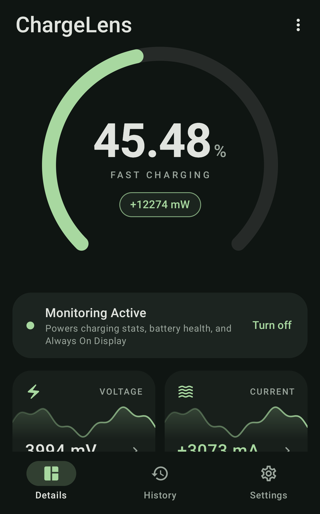
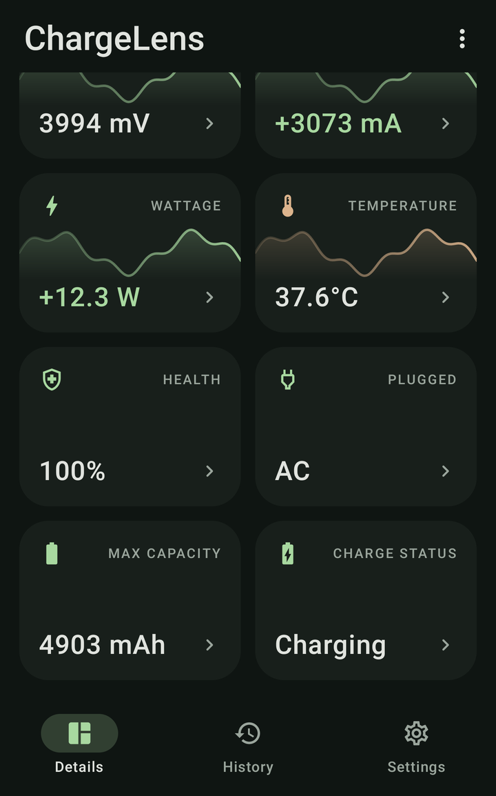
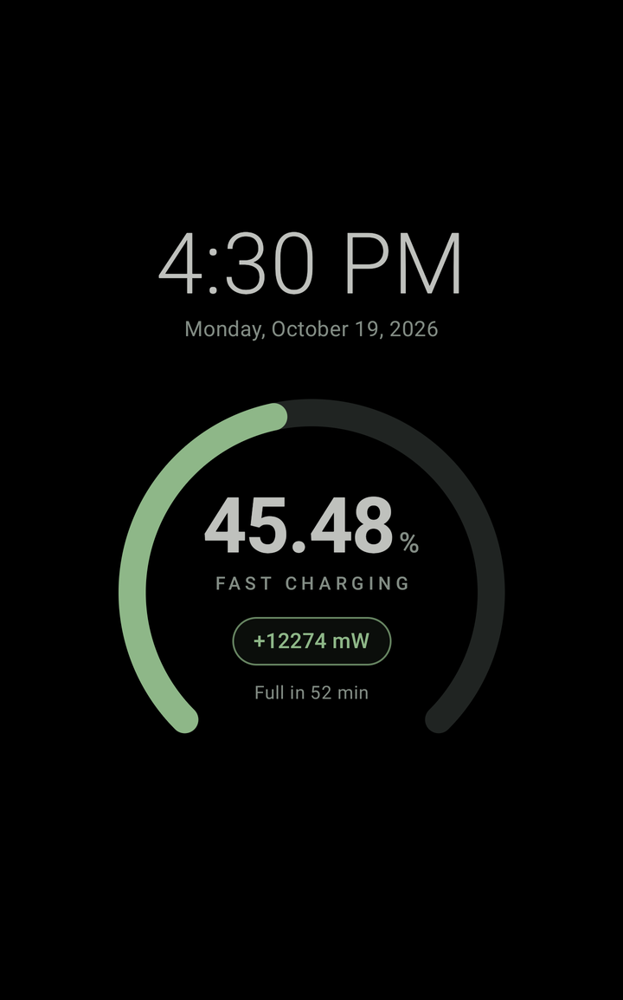
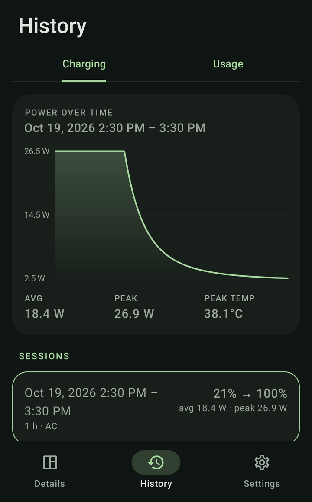
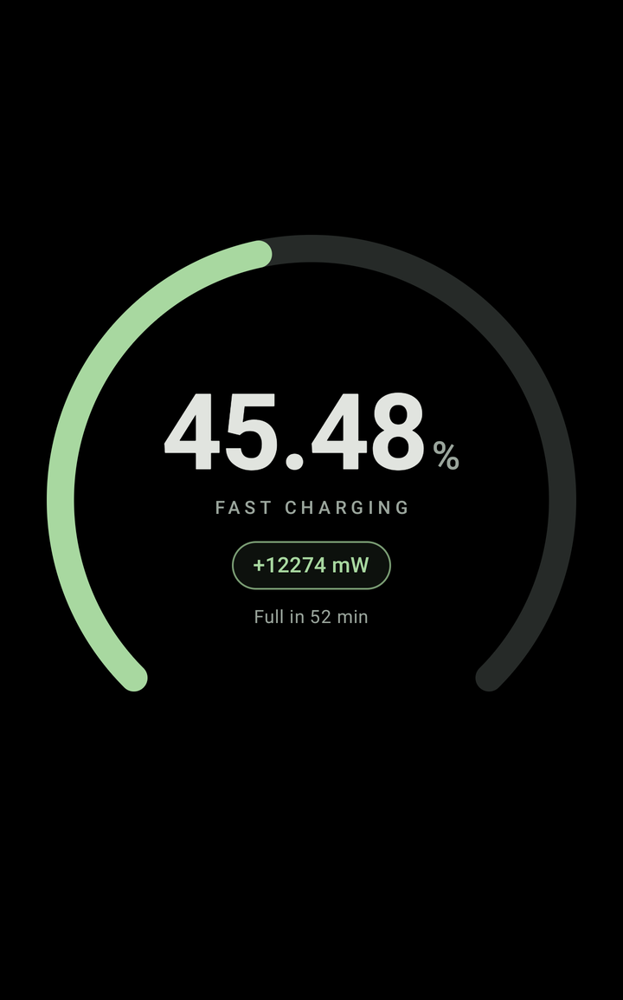

<h1 align="center">ChargeLens</h1>

<p align="center">
  A live battery and charging monitor for Android.<br>
  Precise percentage, real-time power, a full-screen charging view and an always-on gauge while charging.
</p>

<p align="center">
  <a href="https://github.com/laadpiyush/ChargeLens/releases/latest/download/ChargeLens.apk"></a>
  <a href="https://github.com/laadpiyush/ChargeLens/releases/latest"></a>
  
  <a href="LICENSE"></a>
</p>

<p align="center">
  
  
  
  
  
</p>

## Download

**[⬇ Download ChargeLens.apk](https://github.com/laadpiyush/ChargeLens/releases/latest/download/ChargeLens.apk)** (latest release, about 1 MB)

1. Open the link on your phone and download the APK.
2. Tap the file to install it. If Android asks, allow your browser or file manager to *install unknown apps*.
3. Open ChargeLens and allow notifications.

To update, install a newer APK over the old one. Your data is kept.

ChargeLens has **no internet permission**. Nothing leaves your phone.

## Features

- **Live gauge**: battery percentage to two decimals (from the fuel gauge's charge counter), charging speed (slow, normal, fast or super fast), and signed power in mW. Tap the gauge for time to full or time remaining.
- **Eight metric tiles**: voltage, current, wattage, temperature, health, plug type, maximum capacity and charge status. The first four have live sparklines. Tap any tile for a larger graph and the session's min, max and average.
- **Charging screen**: plug in with the screen on, and the Details screen opens full-screen with a close button.
- **Always-on gauge while charging**: when the screen turns off on the charger, a dim clock and gauge appear on pure black over the lock screen. Tap it to go to the lock screen; press power to turn it off.
- **Screen saver**: the gauge alone, as an Android screen saver.
- **History**: charge sessions with a power-over-time chart, average and peak watts, and peak temperature. A **Usage** tab shows screen-on and screen-off drain.
- **Battery friendly**: by default, ChargeLens only monitors while charging, and nothing runs on battery. An option keeps a dormant listener so the charging views open by themselves when you plug in.
- **Design**: accent colour, gauge thickness, system or mono numbers, AMOLED black, and which tiles to show in which order.
- **Handles device differences**: corrects the current sign and unit across manufacturers, with manual overrides. Values the phone doesn't report show as "N/A".
- **CSV export** of sessions and samples.

## Permissions

| Permission | Used for |
|---|---|
| Notifications | Live monitoring notification and charging prompts |
| Full-screen alerts (Android 14+) | Showing the charging screen and always-on gauge over the lock screen |
| Display over other apps *(optional)* | Opening the charging views while another app is open; overlay mode |
| Unrestricted battery *(optional)* | Stops aggressive OEM battery savers from killing monitoring |

Grant or check each one in **Settings → Permissions** inside the app.

## Monitoring modes

| Setting | On battery | When you plug in |
|---|---|---|
| *Only while charging* on, *Wait for charger in background* **off** (default) | Nothing runs | Open ChargeLens once; it monitors until you unplug |
| *Only while charging* on, *Wait for charger in background* **on** | Dormant listener, no sampling | Charging screen and always-on gauge open by themselves |
| *Only while charging* **off** | Full monitoring, including drain stats in Usage | Same as above |

Android 8+ doesn't deliver *charger connected* events to apps that aren't running. That's why opening by itself on plug-in needs the dormant listener.

## Build from source

Requirements: JDK 17+ and the Android SDK (compileSdk 35).

```bash
git clone https://github.com/laadpiyush/ChargeLens.git
cd ChargeLens
./gradlew :app:assembleRelease                # APK in app/build/outputs/apk/release/
./gradlew :app:testDebugUnitTest              # battery maths and sign normalisation (JVM)
./gradlew :app:connectedDebugAndroidTest      # Compose UI tests (use an emulator)
```

Release builds are signed with the key configured in `~/.gradle/gradle.properties` (`CHARGELENS_STORE_FILE`, `CHARGELENS_STORE_PASSWORD`, `CHARGELENS_KEY_ALIAS`, `CHARGELENS_KEY_PASSWORD`). Without it, they fall back to your local debug key.

### Stack

Kotlin · Jetpack Compose (Material 3) · Hilt · Room · DataStore · Coroutines/Flow. There are no chart libraries: the gauge, sparklines and charts are drawn with Compose `Canvas`.

```
domain/        Pure Kotlin: models, BatteryMath, SnapshotProcessor (unit/sign detection, EMA, series, stats)
data/          BatteryReader, BatteryRepository, DataStore settings, Room history, CSV export
service/       MonitoringService (special-use foreground service), charging-screen launcher,
               overlay, screen saver (DreamService), boot receiver, notifications
ui/            details, charging (full-screen + always-on), history (charging/usage), settings, design,
               components (BatteryGauge, Sparkline, MetricTile, LineChart, MonitoringCard)
```

## Device notes

- **Current sign:** Pixel and most AOSP builds report positive while charging. Many Samsung, Xiaomi and some Qualcomm builds report the opposite. *Auto* mode takes the sign from the charging status; Settings has *As reported* and *Inverted* overrides.
- **Current unit:** some phones report mA instead of µA. ChargeLens detects this automatically, and you can set it manually in Settings.
- **Precise percentage:** some fuel gauges (Samsung, for example) update the charge counter only every few seconds. The number then steps rather than moving smoothly, and it never goes backwards while charging.
- **Design capacity / health:** these come from the system's power profile when it's available. If not, enter the capacity in Settings → Battery.
- **Screen saver on Samsung:** One UI hides the screen saver page. Open it from ChargeLens' ⋮ menu → *Screen saver settings*.
- **Aggressive battery savers** (Samsung, Xiaomi, OnePlus, Huawei and others): see [dontkillmyapp.com](https://dontkillmyapp.com).

### Simulating charging with adb

```bash
adb shell dumpsys battery set ac 1 && adb shell dumpsys battery set status 2   # plug in
adb shell input keyevent 26                                                   # screen off → always-on gauge
adb shell dumpsys battery unplug                                              # unplug → views close
adb shell dumpsys battery reset                                               # back to real values
```

## License

```
Copyright 2026 Piyush Laad

Licensed under the Apache License, Version 2.0 (the "License");
you may not use this project except in compliance with the License.
You may obtain a copy of the License at

    http://www.apache.org/licenses/LICENSE-2.0

Unless required by applicable law or agreed to in writing, software
distributed under the License is distributed on an "AS IS" BASIS,
WITHOUT WARRANTIES OR CONDITIONS OF ANY KIND, either express or implied.
```

See [LICENSE](LICENSE) for the full text. Third-party libraries (AndroidX, Jetpack Compose, Kotlin, Dagger/Hilt) are also under Apache 2.0.
